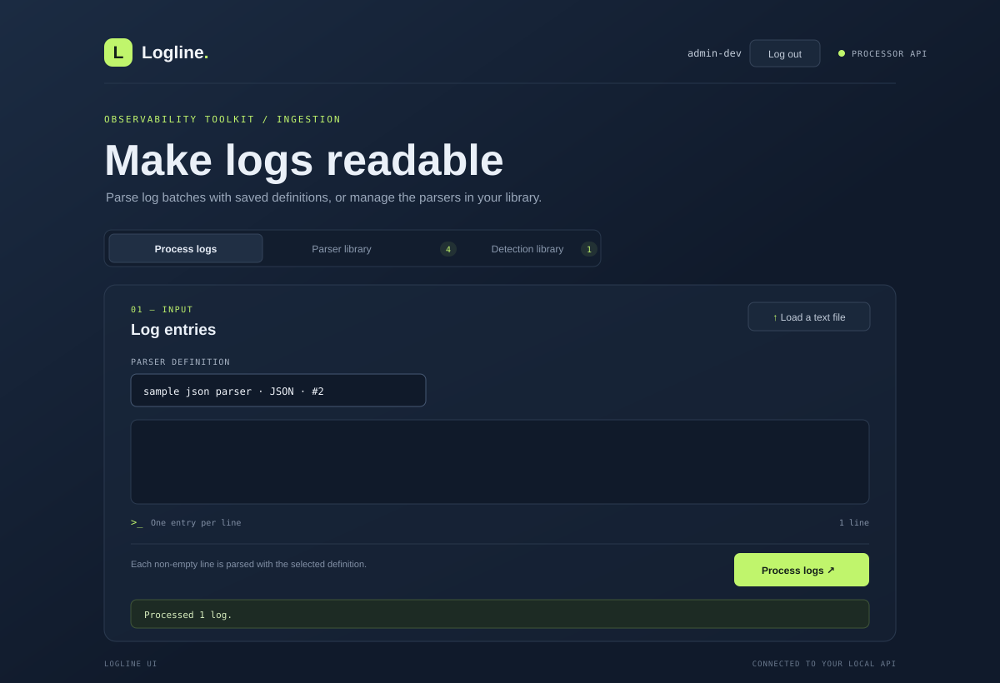
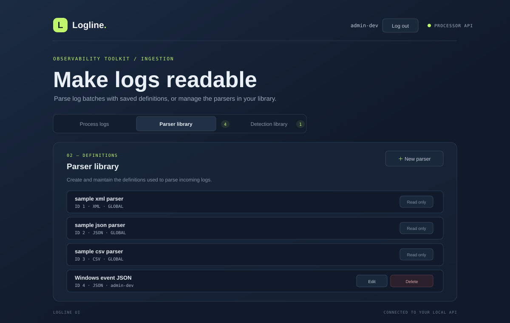
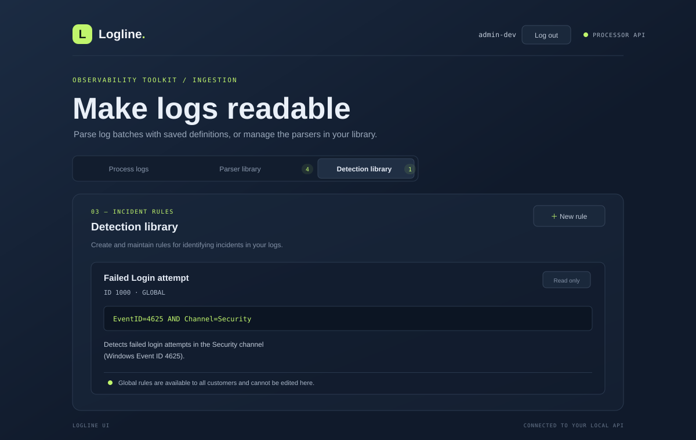

# Tenex Log Processor

Tenex Log Processor is a Spring Boot REST API and browser UI for parsing batches of log lines, removing sensitive fields from parsed output, and detecting incidents with configurable rules. The UI provides a workspace for processing logs and managing parser definitions and detection rules.

## Features

- Java 17 and Spring Boot 3 REST API.
- XML, JSON, and CSV log parsers.
- Recursive removal of configured fields from parsed JSON output.
- Redis-backed parser definitions, detection rules, ID sequences, and login tokens.
- Rule evaluation against parsed log fields, with matching incidents returned per log.
- Customer-scoped records, with shared read-only `GLOBAL` definitions and rules.
- Browser UI and Swagger/OpenAPI documentation.

## UI screenshots

The following captures show the main log-processing workspace and the parser and detection libraries.







## Setup and run locally

Run these steps in order. Keep Redis and the Spring API running while using the UI.

### 1. Start Redis

Redis is the application's storage backend and must be available before the API starts:

```bash
docker run --rm --name tenex-redis -p 6379:6379 redis:7-alpine
```

The API connects to `localhost:6379` by default.

### 2. Build and start the Spring API

From the repository root:

```bash
mvn clean package
mvn spring-boot:run
```

The API starts on port `8080`. On startup, it initializes any missing global sample parser definitions and the built-in failed-login detection rule in Redis. Existing startup records are preserved.

### 3. Build and start the UI

To run the UI in Docker from the repository root:

```bash
docker build -t logs-processor-ui ./ui
docker run --rm --add-host=host.docker.internal:host-gateway -p 3000:3000 logs-processor-ui
```

Open <http://localhost:3000>. The UI container proxies API requests to `http://host.docker.internal:8080`. The `--add-host` option is needed for Docker on Linux so the UI container can reach the API on the host. To use a different API address, set `API_BASE_URL` when starting the UI container.

Alternatively, run the UI directly with Node.js:

```bash
npm --prefix ui start
```

Open <http://localhost:3000>; the local UI server proxies to `http://localhost:8080` by default.

## Authentication and customer scope

Sign in through the UI with the development credentials `admin-dev` / `admin@123`. Login returns a bearer token and customer name. For every API route except login, send both headers:

```http
Authorization: Bearer <accessToken>
X-Customer-Name: <customerName>
```

The API verifies that the customer-name header matches the identity associated with the bearer token; the header alone does not grant access. Tokens expire after eight hours and are stored in Redis by SHA-256 digest. The UI keeps the token and customer name for the current browser tab and clears them after successful logout.

The demo credentials are hardcoded for local development and must not be used in production. Parser definitions and detection rules belong to the authenticated customer or to `GLOBAL`. Customers can see their own records and global records; global records cannot be modified or deleted through customer CRUD APIs. Customer names are assigned by the authenticated API context, not accepted from request bodies.

## API reference

Base URL: `http://localhost:8080`. JSON request and response bodies use `Content-Type: application/json`. All routes except `POST /api/auth/login` require the authentication headers above.

### Authentication

| Method and path | Request | Response and meaning |
|---|---|---|
| `POST /api/auth/login` | `{"username":"admin-dev","password":"admin@123"}` | `200`: `{"customerName":"admin-dev","accessToken":"..."}`. Issues a token for the configured development account. |
| `GET /api/auth/session` | Authentication headers | `200`: `{"customerName":"admin-dev","accessToken":null}`. Confirms the authenticated customer context. |
| `POST /api/auth/logout` | Authentication headers | `204` with no body. Revokes the bearer token. |

Invalid login credentials or an invalid, expired, or mismatched token/customer header are rejected with `401 Unauthorized`.

### Process logs

`POST /api/logs/process` parses every submitted line with the selected parser and checks each successfully parsed log against the visible detection rules.

Request:

```json
{
  "logs": ["{\"EventID\":\"4625\",\"Channel\":\"Security\"}"],
  "parserId": 2
}
```

`logs` must be a non-empty array of strings. `parserId` is required and must identify a parser visible to the authenticated customer.

Response (`200`):

```json
{
  "results": [
    {
      "log": "{\"EventID\":\"4625\",\"Channel\":\"Security\"}",
      "parsedOutput": "{\"EventID\":\"4625\",\"Channel\":\"Security\"}",
      "notes": "Parsed successfully using JSON.",
      "matchedIncident": ["1000-Failed Login attempt"]
    }
  ]
}
```

Each result corresponds to one input line. `parsedOutput` is a JSON-encoded string. `matchedIncident` contains matching rules as `id-Name` strings, or an empty array when none match. CSV output is a JSON array when no columns are configured; when columns are configured, it is a JSON object keyed by those column names.

If any log cannot be parsed, the endpoint responds with `500 Internal Server Error` and a JSON error body instead of returning partial results. The UI displays the error message from the response. For example:

```json
{
  "status": 500,
  "error": "Internal Server Error",
  "message": "Log processing failed for XML input: Unable to parse XML log"
}
```

#### Sample logs for testing

Select the matching sample parser in the UI, or use its `parserId` from `GET /api/definitions`, then submit the corresponding log. The built-in failed-login rule matches the JSON example.

**XML** — use the `sample xml parser`. An `<Event>` root is omitted from parsed output; its child elements become root keys:

```xml
<Event><EventID>4625</EventID><Channel>Security</Channel><Message>Failed login</Message></Event>
```

This parses to `{"EventID":"4625","Channel":"Security","Message":"Failed login"}`. Other XML root elements remain in the output as a named root object.

**JSON** — use the `sample json parser`:

```json
{"EventID":"4625","Channel":"Security","Message":"Failed login"}
```

**CSV** — use the `sample csv parser`; the UI sample button loads all three records from `src/main/resources/sampleCSVLog.txt`:

```csv
2026-11-13T15:30:12Z,203.0.113.42,-,POST /api/v1/auth/login,401,142,0.045,https://app.example.com/login,python-requests/2.31.0
```

Each log is one string in the `logs` array; submit one request per parser type because each request selects a single `parserId`. The UI's **Load sample logs** button fills the input from the matching classpath resource: `sampleXMLLog.txt`, `sampleJsonLog.txt`, or `sampleCSVLog.txt`. The startup `sample csv parser` uses the columns `@timestamp`, `clientip`, `remote_user`, `request`, `status`, `body_bytes_sent`, `request_time`, `http_referrer`, and `http_user_agent`, so the sample rows parse to keyed JSON objects. CSV values remain strings.

### Parser definitions

Parser create and update request:

```json
{
  "parserName": "Windows JSON",
  "parserType": "JSON",
  "fieldsToRemove": ["password", "token"],
  "columns": []
}
```

`parserName` is required. `parserType` is one of `XML`, `JSON`, or `CSV`. `fieldsToRemove` is optional; matching keys are removed recursively from parsed JSON output. `columns` is optional and applies to CSV definitions: provide one unique name per value, in field order, to use those names as keys in the parsed JSON object. If omitted or empty, CSV output remains a JSON array. For example, with `columns: ["EventID", "Channel", "Message"]`, `4625,Security,Failed login` becomes `{"EventID":"4625","Channel":"Security","Message":"Failed login"}`. The number of configured columns must match the number of CSV values. Parser IDs are assigned incrementally and should not be supplied in create/update request bodies.

| Method and path | Request | Response and meaning |
|---|---|---|
| `GET /api/definitions` | None | `200`: list parser definitions visible to this customer, including `GLOBAL` definitions. |
| `GET /api/definitions/{parserId}` | None | `200`: one visible definition. |
| `POST /api/definitions` | Parser definition JSON | `201`: creates a definition in the authenticated customer's scope and returns it. |
| `PUT /api/definitions/{parserId}` | Parser definition JSON | `200`: replaces the editable fields of the customer's definition and returns it. |
| `DELETE /api/definitions/{parserId}` | None | `204`: deletes the customer's definition. |

Global definitions are visible but read-only. Requests for unavailable definitions return `404`; attempts to modify or delete global definitions return `403`.

### Detection rules

Detection-rule create and update request:

```json
{
  "name": "High error rate",
  "ruleLogic": "level EQUAL ERROR",
  "description": "Detects error-level log entries."
}
```

All three fields are required, and `ruleLogic` must use valid rule syntax. Rule IDs are assigned incrementally as four-digit numbers (`1000`–`9999`) and should not be supplied in create/update request bodies. Rule logic compares parsed log fields to values. Supported comparison operators are `=`, `!=`, `<`, `>`, and their names `EQUAL`, `NOT_EQUAL`, `LESS_THAN`, `GREATER_THAN`. Conditions can be combined with `AND` and `OR`; field paths can use dot notation for nested JSON objects. Ordered comparisons require both values to be numbers or both to be strings; missing or incompatible values do not match.

| Method and path | Request | Response and meaning |
|---|---|---|
| `GET /api/detection-rules` | None | `200`: list rules visible to this customer, including `GLOBAL` rules. |
| `GET /api/detection-rules/{id}` | None | `200`: one visible rule. |
| `POST /api/detection-rules` | Detection rule JSON | `201`: creates a rule in the authenticated customer's scope and returns it. |
| `PUT /api/detection-rules/{id}` | Detection rule JSON | `200`: updates the customer's rule and returns it. |
| `DELETE /api/detection-rules/{id}` | None | `204`: deletes the customer's rule. |

Global rules are visible but read-only. Requests for unavailable rules return `404`; attempts to modify or delete global rules return `403`.

## Redis data and startup defaults

Parser definitions and detection rules are stored in Redis with a `customerName` scope. Redis also holds the sequences used to assign parser IDs and four-digit detection-rule IDs, and the short-lived login-token records. The default Redis address is `localhost:6379`.

At application startup, the API ensures the following shared `GLOBAL` records exist:

- `sample xml parser` with type `XML`
- `sample json parser` with type `JSON`
- `sample csv parser` with type `CSV` and columns matching the access-log sample resource
- `Failed Login attempt`, with logic `EventID="4625" AND Channel="Security"`

Missing sample parser definitions are created at startup without overwriting existing definitions. The built-in `Failed Login attempt` rule is created if missing and reset to the documented name, logic, and description on every startup; its existing ID is preserved.

## API documentation

With the Spring API running, open Swagger UI at <http://localhost:8080/swagger-ui.html>.

## Declarations

- **AI assistance:** GitHub Copilot was used during development.
- **Sample content:** Sample logs and detection rules were sourced from Gemini.
